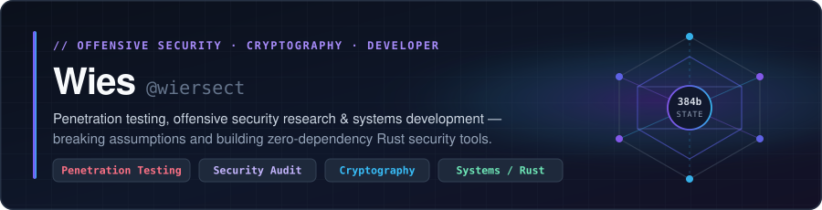
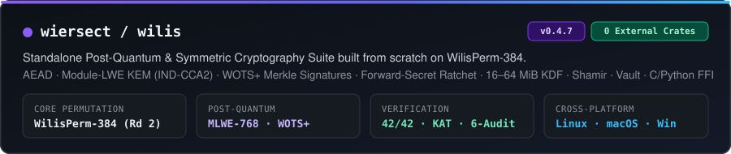

  <picture>
    <source media="(prefers-color-scheme: dark)" srcset="./assets/header-dark.svg" />
    <source media="(prefers-color-scheme: light)" srcset="./assets/header-light.svg" />
    
  </picture>

 

  
  
  
  

---

### Focus & Engineering Principles

I design and audit **self-contained cryptographic software** built from first principles — favoring transparent mathematics, constant-time execution, atomic filesystem safety, and zero third-party supply-chain bloat.

| Area | What I Build & Audit |
| :--- | :--- |
| **Symmetric Primitives** | Custom sponge permutations (`WilisPerm-384`), ARX + bitsliced nonlinear layers (`Chi-5` / `Feistel-6`), duplex AEAD, keyed sponge MAC, XOF, and hybrid memory-hard KDFs |
| **Post-Quantum Cryptography** | Constant-time Module-LWE IND-CCA2 KEM (Fujisaki-Okamoto implicit rejection), hybrid public-key containers (`WPKE`), and stateful hash-based `WOTS+` Merkle signatures |
| **Systems & Memory Safety** | Zero-dependency pure Rust (`std` only), volatile secret zeroization, panic-safe C99 ABI (`libwilis`), Python `ctypes` FFI, and symlink/TOCTOU-safe atomic persistence |
| **Adversarial Verification** | Locked Known-Answer Test Vectors (KAT), mutation parser fuzzing, live SAC/BIC/DDT/LAT/NIST statistical audits, and multi-OS CI (`-D warnings`, C99 `-Wall -Wextra -Werror`) |

---

### Flagship Project

  <a href="https://github.com/wiersect/wilis">
    <picture>
      <source media="(prefers-color-scheme: dark)" srcset="./assets/wilis-card-dark.svg" />
      <source media="(prefers-color-scheme: light)" srcset="./assets/wilis-card-light.svg" />
      
    </picture>
  </a>

 

| Quick Links | Details |
| :--- | :--- |
| **[Repository](https://github.com/wiersect/wilis)** | Full flat-layout pure-Rust implementation (`core/`, `aead/`, `kem/`, `sign/`, `ratchet/`, `kdf/`, `split/`, `stream/`, `archive/`, `vault/`, `audit/`, `ffi/`) |
| **[Cryptographic Specification](https://github.com/wiersect/wilis/blob/main/SPECIFICATION.md)** | Complete mathematical spec & binary wire formats (`WILS` v1/v2, `WPKE`, `WKP1`/`WKS1`/`WKC1`, `WSK1`/`WPK1`/`WSIG`, `WRAT`, `WSHR`, `WDIR`, `WVLT`) |
| **[Security Policy & Audit Log](https://github.com/wiersect/wilis/blob/main/CHANGELOG.md)** | 7 consecutive full-codebase red-team audit releases (`v0.4.1`–`v0.4.7`), locked cross-architecture KAT vectors & zero-dependency enforcement |
| **[Prebuilt Binaries](https://github.com/wiersect/wilis/releases)** | Automated native builds & checksums for Linux (`x86_64`), macOS (`ARM64`), and Windows (`x86_64`) |

---

### Stack & Tooling

  
  
  
  
  
  

---

  <code>Built from first principles · Zero external dependencies · Kerckhoffs's Principle</code>

